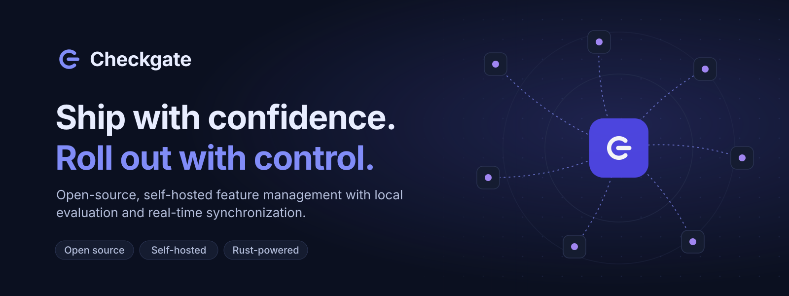
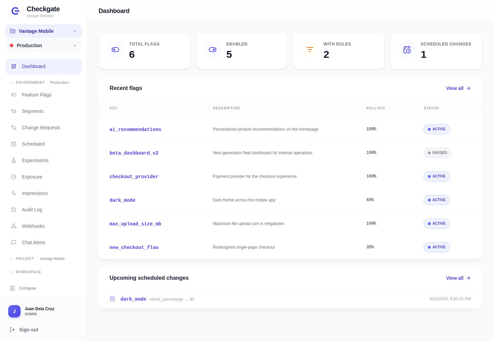
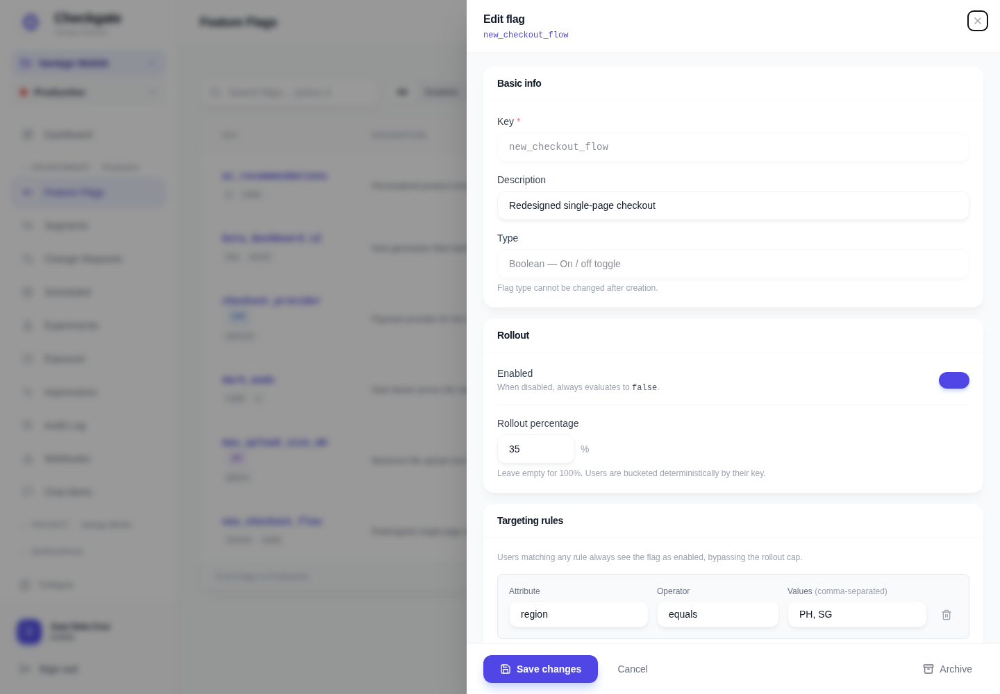
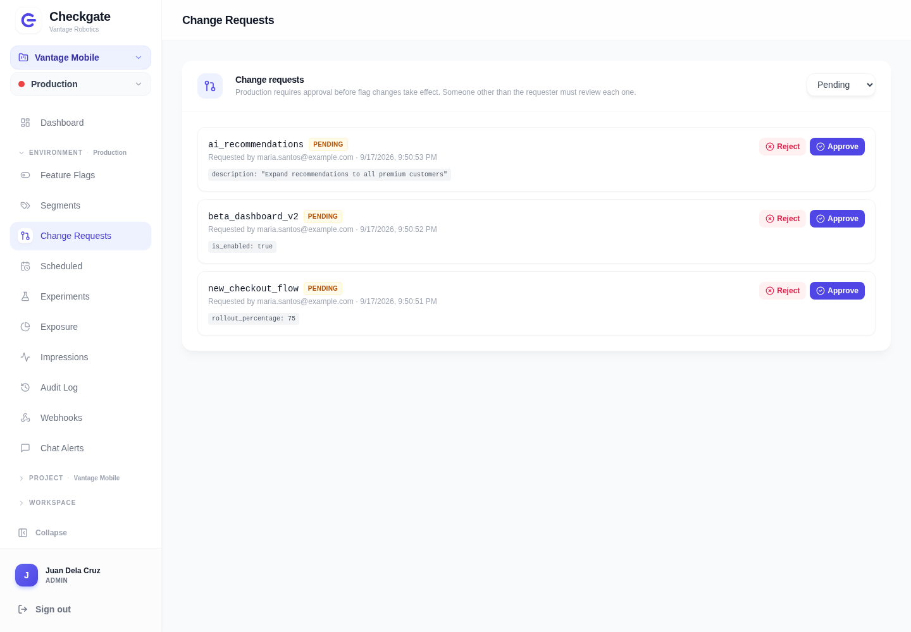
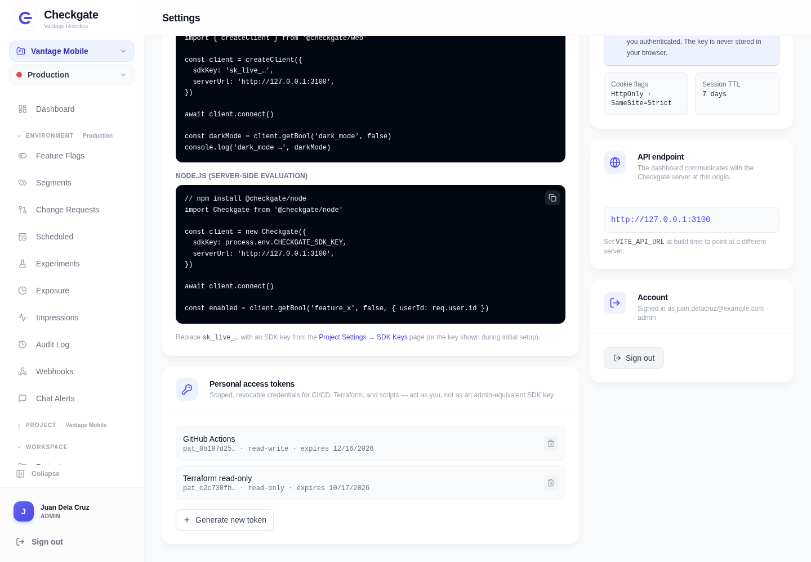

<p align="center">
  <picture>
    <source media="(prefers-color-scheme: dark)" srcset="assets/banner-dark.svg">
    <source media="(prefers-color-scheme: light)" srcset="assets/banner-light.svg">
    
  </picture>
</p>

# Checkgate — Feature Flags Without the Round-Trip.

[](https://github.com/checkgate-sh/checkgate/actions/workflows/ci.yml)
[](LICENSE)
[](https://www.npmjs.com/package/@checkgate/node)
[](https://www.npmjs.com/package/@checkgate/web)
[](https://www.npmjs.com/package/@checkgate/react-native)

**Checkgate is an open-source feature flag engine that evaluates flags locally — no network call, no latency, no SaaS vendor.** Every flag decision happens inside your process, while a persistent SSE stream keeps every SDK instance in sync, typically within tens of milliseconds of a change.

It is proudly built in Rust and ships with native SDKs for Node.js (NAPI), browsers (WebAssembly), React Native (JSI), and Flutter (FFI). In the v0.1.31 benchmark, a change reached 1,000 connected SDK clients with a p50 of 39 ms, and none of 1.2 million deliveries was missed.

**[Explore the Documentation →](https://checkgate-sh.github.io/checkgate)**

---

## Overview

<p align="center">
  <picture>
    <source media="(prefers-color-scheme: dark)" srcset="assets/overview-dark.svg">
    
  </picture>
</p>

<p align="center">
  <em>A flag change is written once, then pushed to every connected SDK in milliseconds — after which each <code>isEnabled()</code> is a local, in-process lookup.</em>
</p>

---

## Quick start

Run the all-in-one image (PostgreSQL, Redis, the server and the dashboard in one container). Save as `compose.yml`:

```yaml
services:
  checkgate:
    image: ghcr.io/checkgate-sh/checkgate:latest
    ports:
      - "3000:3000"
    environment:
      POSTGRES_PASSWORD: ${POSTGRES_PASSWORD:-checkgate}
      SESSION_SECRET: ${SESSION_SECRET:-}
      COOKIE_SECURE: ${COOKIE_SECURE:-false}
    volumes:
      - checkgate_pgdata:/var/lib/postgresql/data
      - checkgate_redis:/var/lib/redis
    restart: unless-stopped

volumes:
  checkgate_pgdata:
  checkgate_redis:
```

```bash
docker compose up -d   # then finish the setup wizard at http://localhost:3000/setup
npm install @checkgate/node
```

```typescript
import { CheckgateClient } from '@checkgate/node'

const client = new CheckgateClient({ serverUrl: 'http://localhost:3000', sdkKey: 'sk_live_your_key_here' })
await client.connect()

// Evaluated in-process: no network call per decision.
const enabled = client.isEnabled('new-checkout-flow', 'user-123', { plan: 'pro' })
```

The full walkthrough (first flag, SDK keys, production settings): [Getting Started](docs/guide/getting-started.md).

---

## Features

- **In-process evaluation** — flags are evaluated in local memory: well under a microsecond in the Rust core, 0.8–4 µs through the Node.js SDK
- **Real-time updates** — SSE push, not polling; changes typically land in tens of milliseconds
- **Targeting rules** — match by any user attribute (`email`, `plan`, `region`, …)
- **Percentage rollouts** — deterministic MurmurHash3 bucketing; sticky and independent per flag
- **Rust evaluation core** — compiled to NAPI, WASM, JSI, or FFI depending on platform
- **Self-hosted** — single binary + PostgreSQL + Redis; your data never leaves your infra

---

## Architecture & Performance

*Local evaluation. Real-time updates. Lightweight infrastructure.*

<p align="center">
  <picture>
    <source media="(prefers-color-scheme: dark)" srcset="assets/benchmarks/performance-dark.svg">
    
  </picture>
</p>

Measured on v0.1.31, and on v0.1.30 again in the same session with runs alternated, on a 4-core Intel laptop in desktop use. The server ran in Docker with a 1 vCPU / 512 MiB limit; 3 runs per measurement, 6 for propagation. The higher pooled p99 comes from two runs made while the host was still loaded; the reasons are in the methodology.
Methodology, every run and the raw data: [Public benchmarks](docs/performance/benchmarks.md).

---

## Infrastructure Cost & Savings

*Understand the infrastructure required to run your own feature flags.*

<p align="center">
  <picture>
    <source media="(prefers-color-scheme: dark)" srcset="assets/benchmarks/cost-dark.svg">
    
  </picture>
</p>

What one server spends to keep 100 to 10,000 clients up to date over SSE, the same clients polling every 10, 30 or 60 s instead, and that infrastructure priced at dated AWS list prices. Measured, calculated and projected figures are kept apart, and PostgreSQL and Redis are included.
Method, assumptions and sources: [Infrastructure cost and efficiency](docs/performance/cost-efficiency.md).

---

## Screenshots

*Indigo dashboard with the Checkgate gate logo, shown with example data for Vantage Robotics and administrator Juan Dela Cruz. [Explore the dashboard guide](docs/guide/dashboard.md).*

**Dashboard overview** — flag counts, rollout status, and recent activity at a glance.



**Feature flags** — tags, types, rollout percentage, and one-click enable/disable per environment.


**Flag editor** — targeting rules, tags, ownership, and prerequisite (dependent) flags.



**Change requests** — require a second reviewer before a flag change takes effect in sensitive environments; self-approval is blocked.



**Cross-environment diff** — see what's different between environments before promoting, with a one-click sync.


**Personal access tokens** — scoped, revocable API credentials for CI/CD and Terraform, as an alternative to admin-equivalent SDK keys.



**Environments** — isolate configuration across Production, Staging, UAT, and Development, with per-environment approval gates.


**Collapsible sidebar** — reclaim screen space on data-dense pages; the whole dashboard is full-width by default.


---

## Documentation

| Topic | Link |
|-------|------|
| Why Checkgate / comparisons | [What is Checkgate?](docs/guide/what-is-checkgate.md) |
| System architecture | [Architecture](docs/guide/architecture.md) |
| Flags, rules, rollout concepts | [Core Concepts](docs/guide/concepts.md) |
| Dashboard tour | [Dashboard](docs/guide/dashboard.md) |
| Step-by-step setup | [Getting Started](docs/guide/getting-started.md) |
| REST API + SSE stream reference | [API Reference](docs/api-reference.md) |
| Node.js SDK | [SDK: Node.js](docs/sdks/nodejs.md) |
| Web (WASM) SDK | [SDK: Web](docs/sdks/web.md) |
| React Native (JSI) SDK | [SDK: React Native](docs/sdks/react-native.md) |
| Flutter (FFI) SDK | [SDK: Flutter](docs/sdks/flutter.md) |
| Type-safe codegen CLI | [`@checkgate/cli`](cli/README.md) |
| Edge evaluation (Workers, Fly.io) | [`@checkgate/edge`](edge/README.md) |
| SSR / bootstrap (Next.js, Remix, …) | [`@checkgate/ssr`](ssr/README.md) |
| Terraform / OpenTofu provider | [terraform-provider-checkgate](integrations/terraform-provider-checkgate/README.md) |
| Kubernetes operator | [checkgate-operator](integrations/kubernetes-operator/README.md) |
| Docker, AWS, env vars | [Self-Hosting](docs/self-hosting.md) |
| Enterprise Setup & Migration | [Enterprise Setup & Migration](docs/enterprise-setup.md) |

---

## Contributing

See [CONTRIBUTING.md](CONTRIBUTING.md).

## License

Apache License 2.0 — © 2025


