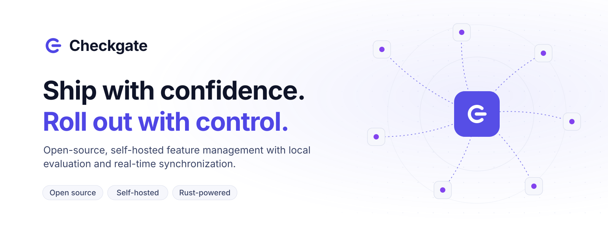
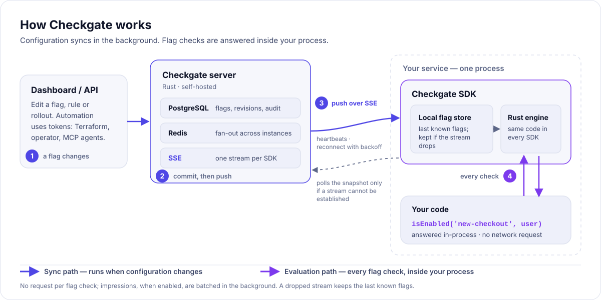

<p align="center">
  <picture>
    <source media="(prefers-color-scheme: dark)" srcset="assets/banner-dark.svg">
    <source media="(prefers-color-scheme: light)" srcset="assets/banner-light.svg">
    
  </picture>
</p>

<p align="center">
  <a href="https://github.com/checkgate-sh/checkgate/actions/workflows/ci.yml"></a>
  <a href="https://github.com/checkgate-sh/checkgate/releases/latest"></a>
  <a href="https://www.npmjs.com/package/@checkgate/node"></a>
  <a href="LICENSE"></a>
  <a href="https://checkgate-sh.github.io/checkgate/"></a>
</p>

<p align="center">
  <a href="https://checkgate-sh.github.io/checkgate/"><b>Documentation</b></a> ·
  <a href="docs/guide/quickstart.md"><b>Quickstart</b></a> ·
  <a href="docs/sdks/index.md"><b>SDKs</b></a> ·
  <a href="docs/self-hosting.md"><b>Self-hosting</b></a> ·
  <a href="CHANGELOG.md"><b>Changelog</b></a>
</p>

**Checkgate is open-source, self-hosted feature management.** Turn a feature on for a percentage of
users, target it by any attribute, require approval before a production change, and turn it off
again with one switch — from the dashboard, the REST API or Terraform.

**Feature flags without the round-trip.** Each SDK keeps your environment's flags in memory and
evaluates them inside your process with the same Rust engine, so a flag check makes no network
request. One Server-Sent Events connection per SDK delivers changes as they happen, with
reconnects, a polling fallback and the last known flags if the server is unreachable. You run the
server, PostgreSQL and Redis on your own infrastructure.

> [!IMPORTANT]
> Upgrading a 0.1.31 server to 0.2.0? Read [Upgrading to 0.2.0](docs/operations/upgrading-to-0-2-0.md)
> first: two database migrations, no rolling upgrade, back up the database before you start.

## How it works

<p align="center">
  <picture>
    <source media="(prefers-color-scheme: dark)" srcset="assets/architecture/overview-dark.svg">
    
  </picture>
</p>

The server distributes configuration; it never evaluates your application's flag checks. If the
stream drops, the SDK keeps serving the last flags it received. See
[Architecture](docs/guide/architecture.md) and [Reliability](docs/operations/reliability.md).

## Quickstart

You need Docker (running) and Node.js 22 or later. From a clone, one script starts a local,
development-only Checkgate, completes setup, creates the flag `new-checkout` (on for the `pro` plan)
and writes an SDK key to `quickstart/.env`:

```bash
git clone https://github.com/checkgate-sh/checkgate.git && cd checkgate
./quickstart/start.sh --seed
cd quickstart/node && npm install && node --env-file=../.env index.mjs
```

The example evaluates the flag in-process and prints `new-checkout: user-pro=true  user-free=false`.
Sign in at <http://localhost:3000> with the printed credentials, switch `new-checkout` off, and the
running example prints the new answer without a restart. `./quickstart/start.sh --down` removes
everything.

The script runs the latest published image and generates throwaway secrets; never reuse its
settings outside your machine. Python, troubleshooting and what the script does:
[Five-minute quickstart](docs/guide/quickstart.md). For a real deployment:
[Getting started](docs/guide/getting-started.md) and [Self-hosting](docs/self-hosting.md).

In your own code:

```typescript
import { CheckgateClient } from '@checkgate/node'

const client = new CheckgateClient({
  serverUrl: 'http://localhost:3000',
  sdkKey: process.env.CHECKGATE_SDK_KEY!,
})
await client.connect()

client.isEnabled('new-checkout', 'user-123', { plan: 'pro' }) // local: no network request
```

## Why Checkgate

- **Local evaluation.** Flags are evaluated in memory by the SDK, so a flag check adds no network
  latency, and keeps answering from the last known flags while the server is unreachable.
- **Real-time synchronization.** Changes reach connected SDKs over SSE, with heartbeats, silent-stream
  detection, reconnects with backoff, a polling fallback and per-flag revision ordering.
  [How sync works](docs/operations/reliability.md).
- **Controlled rollouts and governance.** Targeting rules, reusable segments, prerequisites,
  multivariate flags and sticky percentage rollouts; per-environment change requests with
  self-approval blocked, scheduled changes, an audit log, scoped tokens and webhooks.
- **Self-hosted.** One Rust server binary with PostgreSQL and Redis, or an all-in-one image.
  Apache 2.0. Your flags and users stay on your infrastructure; browser and mobile SDKs download
  their environment's rules, as any local-evaluation SDK does.

## SDKs and integrations

| Runtime | Package | Status |
|---|---|---|
| Node.js | [`@checkgate/node`](docs/sdks/nodejs.md) (NAPI) | npm 0.2.0 |
| Browser | [`@checkgate/web`](docs/sdks/web.md) (WebAssembly) | npm 0.2.0 |
| React Native | [`@checkgate/react-native`](docs/sdks/react-native.md) (JSI) | npm 0.2.0 · Android build verified in CI; iOS not certified |
| Flutter | [`checkgate_flutter`](docs/sdks/flutter.md) (FFI) | pub.dev 0.2.0 · bundles no engine: you build and link it |
| Python | [`checkgate`](docs/sdks/python.md) (PyO3) | PyPI 0.2.0 · new in 0.2.0; CPython 3.11+ |
| OpenFeature | [`@checkgate/openfeature-provider`](docs/sdks/openfeature.md) (Node.js server) | npm 0.2.0 · new in 0.2.0 |
| Express · Fastify · NestJS | [`@checkgate/node-integrations`](docs/sdks/node-frameworks.md) | npm 0.2.0 · new in 0.2.0 |
| SSR / edge | [`@checkgate/ssr`](docs/ecosystem/ssr.md), [`@checkgate/edge`](docs/ecosystem/edge.md) | npm 0.2.0 |
| Typed flags | [`@checkgate/cli`](docs/ecosystem/cli.md) | npm 0.2.0 |
| AI agents | [`@checkgate/mcp-server`](docs/ecosystem/mcp.md) | npm 0.2.0 · new in 0.2.0 · read-only by default; can propose, never apply or approve |
| Infrastructure as code | [Terraform / OpenTofu provider](docs/ecosystem/terraform.md), [Kubernetes operator](docs/ecosystem/kubernetes.md) | build from source |

Every SDK runs the same evaluation engine and checks the same shared test vectors. Also new in
0.2.0: the [evaluation playground](docs/guide/playground.md) (what an SDK would answer for a user,
and why) and [SDK diagnostics](docs/operations/sdk-diagnostics.md). Which packages your stack needs:
[Which SDK do I need?](docs/sdks/index.md)

## Performance

<p align="center">
  <picture>
    <source media="(prefers-color-scheme: dark)" srcset="assets/benchmarks/performance-dark.svg">
    
  </picture>
</p>

Measured on a v0.1.31 release candidate (commit `66cbfec`) on a 4-core Intel laptop in desktop use,
with the server in Docker limited to 1 vCPU / 512 MiB; v0.1.30 was measured in the same session
with runs alternated. 3 runs per measurement, 6 for propagation. The pooled p99 of 198 ms includes
two runs made while the host was still loaded; the methodology explains why. These figures describe
that machine and workload, not a guarantee for yours. v0.2.0 was compared with v0.1.31 in a
controlled A/B on a 6-CPU Linux workstation: no measured regression above 10 %; Rust-core rule
matching and weighted variants are 2.7–4.6 % slower (2–10 ns per evaluation), everything else
unchanged ([CHANGELOG](CHANGELOG.md#performance)).
Methodology, every run and the raw data: [Public benchmarks](docs/performance/benchmarks.md).

## Infrastructure cost

<p align="center">
  <picture>
    <source media="(prefers-color-scheme: dark)" srcset="assets/benchmarks/cost-dark.svg">
    
  </picture>
</p>

Measured, calculated and projected figures are kept apart, and PostgreSQL and Redis are included.
Prices are dated list prices, not a quote. Method, assumptions and sources:
[Infrastructure cost and efficiency](docs/performance/cost-efficiency.md).

## Dashboard

<table>
  <tr>
    <td width="50%"></td>
    <td width="50%"></td>
  </tr>
  <tr>
    <td><b>Overview</b> — flag counts, rollout status and recent activity.</td>
    <td><b>Flag editor</b> — targeting rules, rollout percentage, ownership and prerequisites.</td>
  </tr>
  <tr>
    <td></td>
    <td valign="top"><b>Change requests</b> — a second reviewer approves changes in protected environments; self-approval is blocked.<br><br>Screenshots of the v0.1.31 dashboard with example data. More in the <a href="docs/guide/dashboard.md">dashboard guide</a>.</td>
  </tr>
</table>

## Documentation

- **Start:** [What is Checkgate?](docs/guide/what-is-checkgate.md) · [Quickstart](docs/guide/quickstart.md) · [Getting started](docs/guide/getting-started.md) · [Core concepts](docs/guide/concepts.md)
- **Build:** [SDKs](docs/sdks/index.md) · [Integrations](docs/ecosystem/ssr.md) · [REST API and SSE reference](docs/api-reference.md)
- **Operate:** [Self-hosting](docs/self-hosting.md) · [Upgrading to 0.2.0](docs/operations/upgrading-to-0-2-0.md) · [Reliability](docs/operations/reliability.md) · [Observability](docs/operations/observability.md) · [Production security settings](docs/self-hosting.md#security)
- **Project:** [Roadmap](docs/roadmap.md) · [Changelog](CHANGELOG.md)

## Contributing

Issues and pull requests are welcome; see [CONTRIBUTING.md](CONTRIBUTING.md).

## License

[Apache License 2.0](LICENSE).
