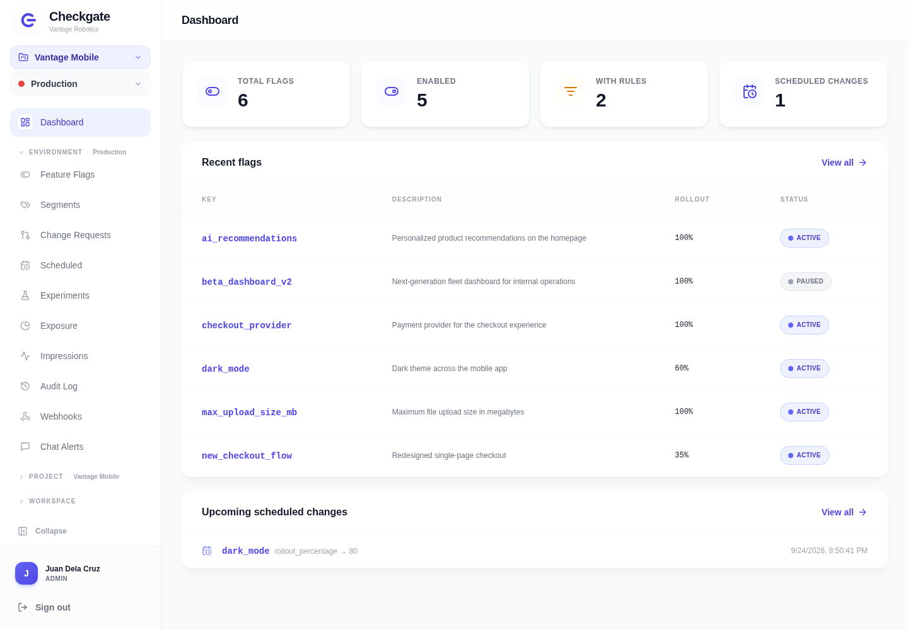
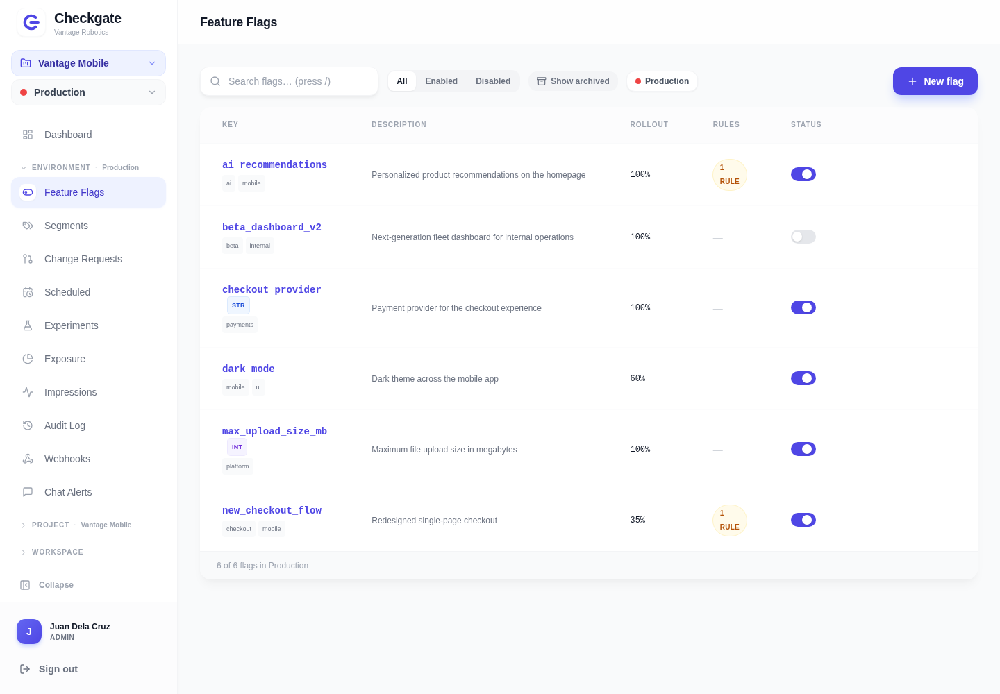
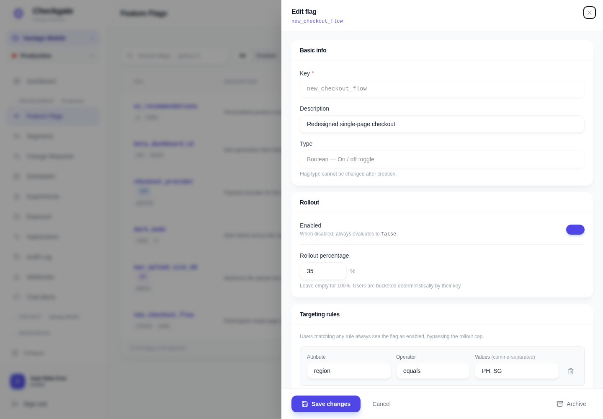
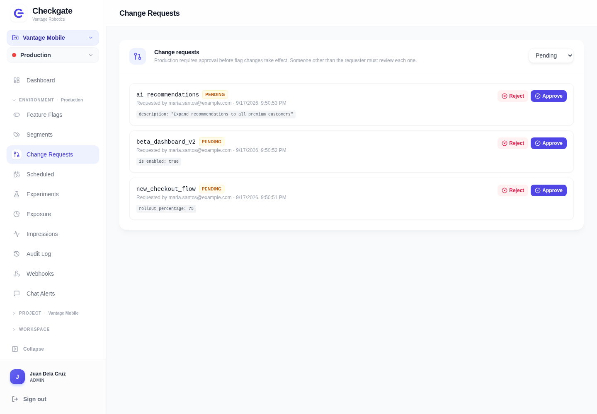
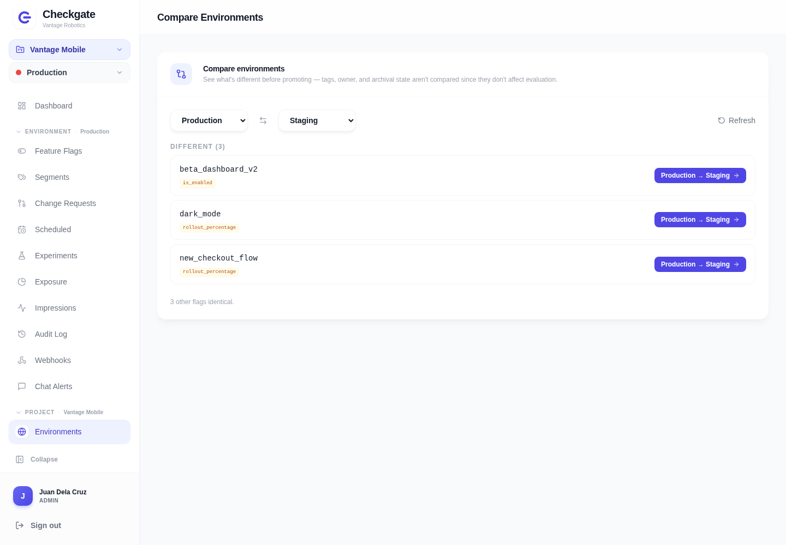
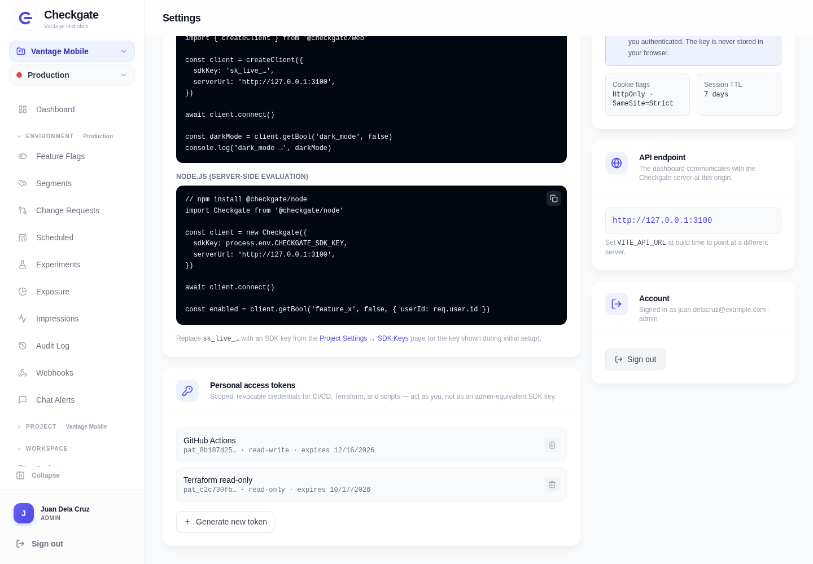
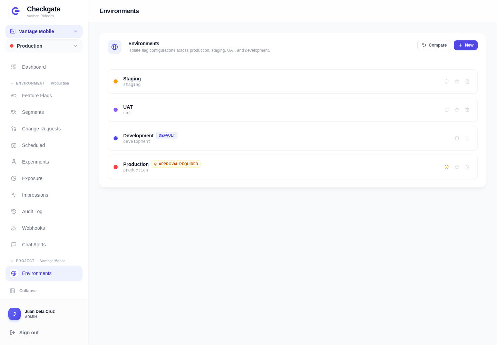
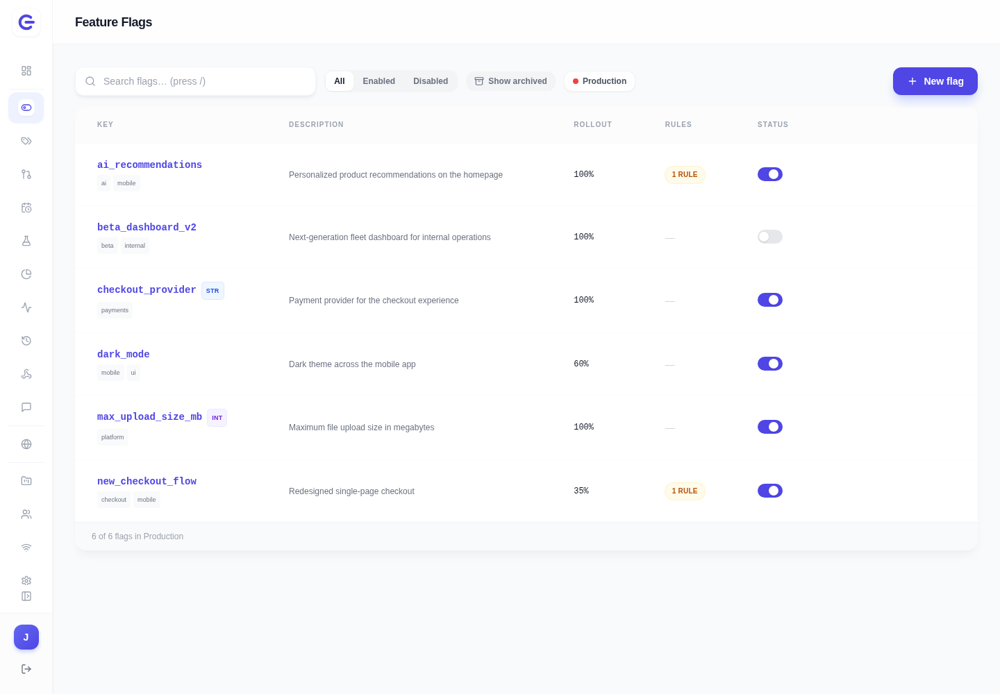

# Dashboard

The dashboard uses Checkgate's indigo brand color and gate logo for navigation, actions,
and enabled state. Amber highlights pending reviews, while gray marks inactive state.
These screenshots show the v0.1.31 dashboard with example data for the fictional Vantage
Robotics workspace, with Juan Dela Cruz as its administrator. The 0.2.0 dashboard adds a
**Playground** entry to the sidebar; everything shown here is unchanged.

## Overview

See flag counts, rollout status, and scheduled changes for the active environment.

## Feature flags

Manage flag types, tags, rollout percentages, and enabled state per environment.

## Flag editor

Edit targeting rules, ownership, tags, and prerequisites in the flag panel.

## Change requests

Review proposed changes before applying them in environments that require approval.
The requester cannot approve their own change.

## Compare environments

Compare flag configuration across environments before promoting a change.

## Personal access tokens

Create scoped credentials for CI/CD, Terraform, and scripts from Settings.

## Environments

Keep Production, Staging, UAT, and Development configuration separate, with approval gates
where your team needs a review.

## Evaluation playground <Since v="0.2.0" />

**Playground** in the sidebar shows what an SDK would answer for a user you describe, and why:
the reason, the rule that matched, the rollout bucket, the weighted variant and each prerequisite.
It is read-only and records nothing. See [Evaluation playground](./playground).

## SDK Health

**SDK Health** (in the workspace section of the sidebar) lists the SDK streams connected to the
server instance that answered, per environment. With a 0.2.0 server it also shows each stream's
last delivered revision and whether every connected SDK has caught up with the newest change.
See [SDK diagnostics](/operations/sdk-diagnostics).

## Collapsible sidebar

Collapse the sidebar to give tables and flag configuration more space.

